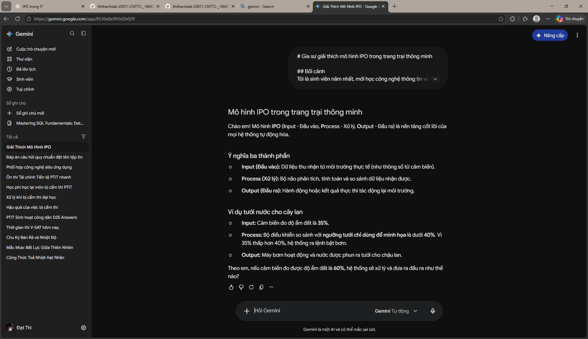

# Gia sư giải thích mô hình IPO trong trang trại thông minh

## Bối cảnh
Tôi là sinh viên năm nhất, mới học công nghệ thông tin và chưa hiểu mô hình IPO. Hãy đóng vai gia sư, giải thích bằng cách nói đơn giản, gần gũi.

## Nội dung
Giải thích mô hình IPO: Input (Đầu vào), Process (Xử lý), Output (Đầu ra), thông qua ví dụ tưới nước tự động cho cây lan.

## Yêu cầu
- [ ] Viết bằng tiếng Việt, tối đa 250 từ.
- [ ] Giải thích ngắn gọn ý nghĩa của từng phần trong IPO.
- [ ] Đưa ra một ví dụ có số đo độ ẩm và ngưỡng tưới giả định.
- [ ] Chỉ rõ đầu vào, bước xử lý và đầu ra trong ví dụ.
- [ ] Nêu rõ ngưỡng tưới chỉ dùng để minh họa.
- [ ] Dùng câu ngắn, từ ngữ dễ hiểu cho sinh viên năm nhất.
- [ ] Chỉ dùng tiếng Anh khi giới thiệu ba từ Input, Process, Output và kèm nghĩa tiếng Việt.
- [ ] Trình bày bằng Markdown với tiêu đề, chữ in đậm và danh sách.
- [ ] Kết thúc bằng một câu hỏi tự kiểm tra, chưa đưa đáp án.

## Không cần
- Không viết mã lập trình hoặc hướng dẫn đấu nối thiết bị.
- Không phân tích thuật toán, giao thức mạng hay cấu tạo cảm biến.
- Không mở rộng sang các chủ đề ngoài ví dụ tưới nước.
